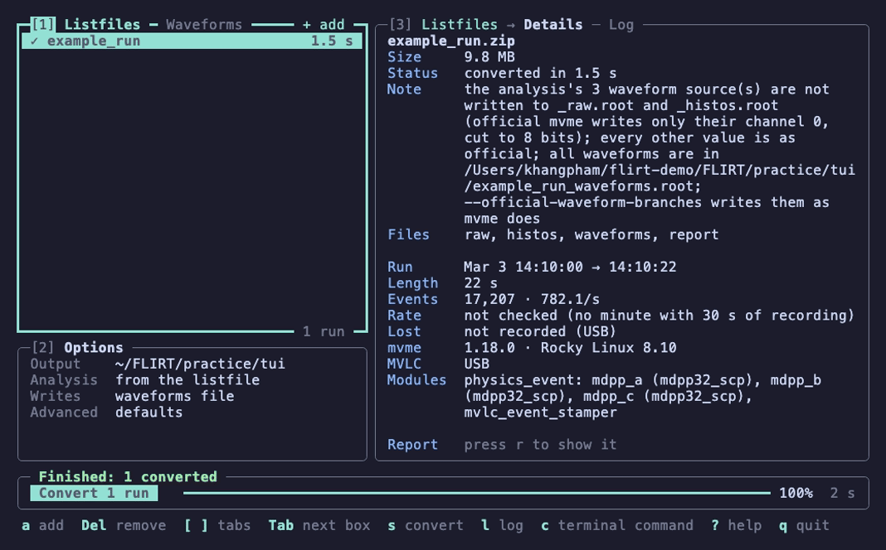

# FLIRT tutorial

This tutorial walks you through FLIRT with a small example run that comes
with it. You convert the run, look at what FLIRT wrote, check the result
against the files mesytec's own software made from the same run, use the
terminal user interface, and see how FLIRT reacts to a bad file name and
to a damaged file. It takes about half an hour.

Everything happens in a practice folder inside the FLIRT folder, so
nothing else on your computer is touched, and at the end you delete that
folder.

## Contents

1. [Before you start](#1-before-you-start)
2. [Look at the run before converting it](#2-look-at-the-run-before-converting-it)
3. [Convert the run](#3-convert-the-run)
4. [The files FLIRT wrote](#4-the-files-flirt-wrote)
5. [Run the same command again](#5-run-the-same-command-again)
6. [Compare with mvme's own files](#6-compare-with-mvmes-own-files)
7. [Convert exactly as mvme did](#7-convert-exactly-as-mvme-did)
8. [The dither offset](#8-the-dither-offset)
9. [The terminal user interface, flirt-tui](#9-the-terminal-user-interface-flirt-tui)
10. [What FLIRT refuses](#10-what-flirt-refuses)
11. [Clean up](#11-clean-up)
12. [Next: your own runs](#12-next-your-own-runs)

## 1. Before you start

**Build FLIRT first**, as [building.md](building.md) describes. The
tutorial uses the programs `flirt-info`, `flirt-convert`, `flirt-tui` and
`compare`.

**The example run.** The folder `examples/` holds a made-up run,
`example_run.zip` ([examples/README.md](../examples/README.md) describes
it). It has the form of a real mvme 1.18.0 recording: about 20 seconds of
data taken over USB, one event with three MDPP-32 modules (`mdpp_a`,
`mdpp_b` and `mdpp_c`) and an event stamper. Its readings are invented:
`mdpp_c` shows peaks at the energies of some gamma lines, and two of the
modules recorded traces (waveforms). `examples/official/` holds the two
ROOT files that mvme 1.18.0 and `mvme_root_client --single-run` made from
it, so you can check FLIRT's files against them.

**Open a terminal and go to the FLIRT folder**, the folder `git clone`
made. All commands below are typed there. For example, if you put FLIRT in
`~/FLIRT`:

```sh
cd ~/FLIRT
```

**Make the programs available by name.** The build wrote a small file
that adds FLIRT's program folder to your terminal's list of places to
look for programs (`PATH`), for this terminal window only. Load it:

```sh
source build/macos/env.sh      # on a Mac
source build/linux/env.sh      # on Linux
```

The commands in this tutorial are written for bash and zsh, the usual
shells on Linux and macOS. If your shell is tcsh (type `echo $0`; its
answer contains `tcsh`), load `env.csh` instead of `env.sh`
(`source build/linux/env.csh`). The other commands work the same in tcsh,
except where a step says otherwise.

To check that it worked, type `flirt-convert --help`: it should print the
program's options.

**Make the practice folder:**

```sh
mkdir practice
```

The outputs below were captured on a Mac. On your computer the times of
day appear in your own time zone, and how long each step takes will
differ.

## 2. Look at the run before converting it

`flirt-info` reads a listfile and tells you what it recorded, without
converting it and without writing anything. It is a quick way to see
which run a file holds:

```sh
flirt-info examples/example_run.zip
```

```text
example_run (examples/example_run.zip, 9.3 MB)
  run           2026-03-03 14:10:00 CST to 14:10:22 CST (22 s), 17207 events (782.1/s)
  lost packets  not recorded (USB)
  rate          not checked (no minute with 30 s of recording)
  recorded by   mvme 1.18.0 on Rocky Linux 8.10 (Green Obsidian) (x86_64), MVLC over USB, jumbo frames unknown, receive buffer unknown
  modules       physics_event: mdpp_a (mdpp32_scp), mdpp_b (mdpp32_scp), mdpp_c (mdpp32_scp), mvlc_event_stamper (mvlc_event_stamper)
```

What the lines say:

- `run`: when the run started and stopped, how long it lasted, how many
  events it recorded and the average rate.
- `lost packets`: over a network (ETH) connection, the MVLC numbers its
  packets, so FLIRT can count those the DAQ computer lost. Over USB there
  are no such numbers, so nothing can be said.
- `rate`: for longer runs, FLIRT looks at the event rate minute by minute
  and warns if it dropped for a while or changed, which can mean the beam
  was off. This run is shorter than a minute, so it is not checked.
- `recorded by`: the mvme version and the DAQ computer's system, as mvme
  logged them during the run.
- `modules`: the event and its modules, each with its module type.

`flirt-info` also accepts a folder. For a folder of several listfiles,
it prints one row per listfile: handy for looking over a whole
experiment.

## 3. Convert the run

```sh
flirt-convert examples/example_run.zip -o practice
```

This converts the listfile into ROOT files in the folder `practice`. The
output folder (`-o`) must exist already; FLIRT does not create it, so a
typing mistake cannot scatter files in a new folder.

While it works, FLIRT shows a progress line. When the run is done, it
prints a summary block. Here it is, followed by `ls practice`, which lists
the files it wrote (step 4):


What to notice:

- The `✓` and "converted" say the run worked.
- `files` lists the endings of the files it wrote (see the next step).
- The `note` is about the run's *analysis*, the mvme analysis saved in
  the listfile, which says what to extract from the data. This one has
  "waveform sources": it asks mvme to put the recorded traces into the
  ROOT files. mvme would keep only channel 0 of each module's traces, cut
  to 8 bits, which is of little use. So by default FLIRT leaves them out
  of the two main files and writes every trace, of every channel, in full,
  into a separate file. Everything else in the files is exactly what mvme
  writes. Step 7 shows how to get mvme's version instead.

## 4. The files FLIRT wrote

```sh
ls practice
```

```text
example_run_histos.root         example_run_waveforms.root
example_run_raw.root            example_run.flirt.json
```

Each file is named after the listfile (`example_run`), as mvme names
them:

- `example_run_raw.root` holds the event tree, `physics_event`: one
  entry per event, with every module's values. It is the same file mvme's
  `mvme_root_client` writes, and the same macros read it.
- `example_run_histos.root` holds the raw histograms, as mvme's client
  makes them: one for each value of each channel (amplitude and time),
  and a few for each module.
- `example_run_waveforms.root` holds the traces: one entry per trace,
  with its event, channel and samples
  ([usage.md, "Waveforms"](usage.md#waveforms) shows how to read it).
- `example_run.flirt.json` is FLIRT's report: what was converted, with
  which FLIRT and options, every check FLIRT made and its result, and the
  run's facts. It is a text file; open it with any text viewer, for
  example `less practice/example_run.flirt.json` (press `q` to leave).

Part of the report, the checks FLIRT made on the input:

```text
  "checks": {
    "I1-archive": {
      "detail": "4 entries in the central directory",
      "result": "pass"
    },
    "I2-listfile-entry": {
      "detail": "'example_run.mvlclst': 13499864 bytes, CRC-32 0x72336b38 as declared",
      "result": "pass"
    },
    ...
```

The most important one is `I2`: the listfile (a `.zip` archive) records a
checksum (CRC-32) and the length of the data inside it, and FLIRT checks
that the data it read match them. If they do not, the file is damaged,
and FLIRT refuses to convert it (step 10 shows this).

The report is always the last file FLIRT puts in place. If a run has its
report, all of its files are complete.

## 5. Run the same command again

```sh
flirt-convert examples/example_run.zip -o practice; echo "exit code $?"
```

The `echo` part prints the program's *exit code*, a number every program
hands back when it ends (0 means all went well). Scripts use it to tell
success from failure.

```text
Converting 1 run into ~/FLIRT/practice

– example_run   skipped: already converted with the same input, options and
    FLIRT build

Done: 1 skipped in 0.1 s.
exit code 0
```

FLIRT found the report from step 3, saw that it was made from the same
listfile, with the same options and the same FLIRT, and skipped the run.
This means you can always run the same command again, for example after
stopping FLIRT halfway through a folder of runs: the runs already done
are skipped, and the rest are converted.

FLIRT never overwrites a file. If you convert the same run with different
options into the same folder, it refuses and tells you which files to
delete first. Try it, with a different experiment name:

```sh
flirt-convert examples/example_run.zip -o practice --experiment-name Test; echo "exit code $?"
```

```text
Converting 1 run into ~/FLIRT/practice

! example_run   not converted: its files exist and the experiment name differs
    why       the report says "Experiment", this run asks for "Test"
    to do     delete _raw.root, _histos.root, _waveforms.root and .flirt.json of
              this run to convert it again

Done: 1 not converted in 0.1 s.
Needs attention:
  ! example_run   its files exist with another experiment name
exit code 1
```

(`--experiment-name` sets the experiment name mvme stores in the files.
mvme takes it from its workspace, not from the listfile; the default is
`Experiment`.)

## 6. Compare with mvme's own files

`compare` checks whether two ROOT files hold the same data: every tree,
every branch, every value of every event, bit for bit, and every histogram.
Give it FLIRT's raw file and mvme's, and with `--histos` the two
histogram files:

```sh
compare practice/example_run_raw.root examples/official/example_run_raw.root \
    --histos practice/example_run_histos.root examples/official/example_run_histos.root
```

(The `\` at the end of the first line continues the command on the next
line. In tcsh it works too; or type it all on one line.)

`compare` prints each check with PASS or FAIL and the differences it
found, and the verdict on the last line. Here it is long; the beginning and
the end (trimmed where it says `...`):

```text
candidate: practice/example_run_raw.root
reference: examples/official/example_run_raw.root
candidate histos: practice/example_run_histos.root
reference histos: examples/official/example_run_histos.root
PASS  raw: keys
FAIL  raw: streamer info (3 differences)
...
FAIL  raw: tree layout (9 differences)
        physics_event;2 fTotBytes: cand=32558798 ref=455646074
        physics_event;2: branch hierarchies differ (cand 48 branches, ref 51)
        physics_event;2: branch only in reference: mdpp_a/mdpp_a_samples[1024]
        physics_event;2: branch only in reference: mdpp_b/mdpp_b_samples[1024]
        physics_event;2: branch only in reference: mdpp_c/mdpp_c_samples[1024]
...
DIFFERENT (0.3 s)
```

This is expected. mvme's files have the waveform branches
(`mdpp_a_samples` and so on) that FLIRT left out (step 3's note), so the
files are not the same. To compare everything else, tell `compare` to
leave out every name that contains `_samples`. On a Mac, also add
`--allow-fused-sumwx2` (explained below):

```sh
compare --ignore-branch-regex _samples --allow-fused-sumwx2 \
    practice/example_run_raw.root examples/official/example_run_raw.root \
    --histos practice/example_run_histos.root examples/official/example_run_histos.root
```

```text
...
PASS  raw: keys
PASS  raw: streamer info
...
PASS  raw: MVMERunInfo
PASS  raw: tree layout
...
PASS  raw: tree values (bitwise)
      info: physics_event;2: compared 17207 entries x 221 slots in 32 leaf branches
...
PASS  histos: keys
      info: IGNORED keys: 0 in candidate, 3072 in reference
PASS  histos: streamer info
PASS  histos: contents (bitwise)
      info: physics_event/mdpp_a_tdc_resolution_code;1 fTsumwx2: cand 109096.9971790015 is the fused sum, ref 109096.99717900148 the separate sum (1 ulp apart)
...
IDENTICAL EXCEPT IGNORED '_samples' (basket layout not compared) AND fTsumwx2 fused rounding in 20 histograms (0.5 s)
```

Every value of all 17,207 events is identical, and so is every histogram,
apart from the branches you told it to leave out.

**What `--allow-fused-sumwx2` is for.** On a Mac with Apple silicon, one
number stored with each histogram, `fTsumwx2` (a sum of squares ROOT uses
for the histogram's RMS), can differ from the Linux value in its very last
digit. ROOT itself computes that sum slightly differently on these
processors. With the option, `compare` recomputes the sum both ways from
the event tree and accepts exactly this difference, nothing else; it lists
each histogram it accepted (the `info` lines). On Linux the option is not
needed, and the verdict is `IDENTICAL EXCEPT IGNORED '_samples' (basket
layout not compared)`.

## 7. Convert exactly as mvme did

To get files that match mvme's in every branch, convert with
`--official-waveform-branches`, which writes the waveform sources the way
mvme does. Use a new folder, because the run's files already exist in
`practice`:

```sh
mkdir practice/as-mvme
flirt-convert examples/example_run.zip -o practice/as-mvme --official-waveform-branches
```

```text
Converting 1 run into ~/FLIRT/practice/as-mvme

✓ example_run   converted in 1.9 s
    run       Mar 3, 2026  14:10:00 → 14:10:22 CST  (22 s)
    events    17,207 (782.1 per second)
    files     _raw.root   _histos.root   _waveforms.root   .flirt.json

Done: 1 converted in 1.9 s.
```

The note is gone, and the waveforms file is still written. Now compare
without leaving anything out (on Linux you may drop
`--allow-fused-sumwx2`):

```sh
compare --allow-fused-sumwx2 \
    practice/as-mvme/example_run_raw.root examples/official/example_run_raw.root \
    --histos practice/as-mvme/example_run_histos.root examples/official/example_run_histos.root
```

The last lines, on a Mac:

```text
PASS  histos: keys
PASS  histos: streamer info
PASS  histos: contents (bitwise)
...
IDENTICAL EXCEPT fTsumwx2 fused rounding in 83 histograms (1.0 s)
```

On Linux the verdict is simply `IDENTICAL`. FLIRT made, without running
mvme, the same files as mvme.

## 8. The dither offset

When `mvme_root_client` writes a value, it adds a random number between 0
and 1 to it ("dither"), so that whole-number readings spread evenly over a
histogram's bins. The random numbers come from one fixed list. The client
starts at the top of the list when it starts, and goes on down the list
from run to run for as long as it keeps running. FLIRT starts at the top
for every file.

So FLIRT matches mvme's file bit for bit only if the client started at the
top for that run too, as it does when it is started for a single run
(`--single-run`), which is how `examples/official/` was made. FLIRT can
read from a file where in the list it started, its *dither offset*:

```sh
flirt-convert --find-dither-offset examples/official/example_run_raw.root
```

```text
examples/official/example_run_raw.root: dither offset 0
```

0 means the top of the list: as expected for a file made with
`--single-run`. A file made by a client that had already converted other
runs gives a larger number. Then `flirt-convert ... --dither-offset-from
<that file>` finds the offset and converts with it in one step. For
physics the offset does not matter; it changes only the random part of
each value.

## 9. The terminal user interface, flirt-tui

`flirt-tui` is FLIRT's terminal user interface (TUI). It does what
`flirt-convert` does, in a screen you control with the keys or the mouse.
It needs a terminal window of at least 80 columns and 24 rows. Start it
with the example and an output folder of its own:

```sh
mkdir practice/tui
flirt-tui examples/example_run.zip -o practice/tui
```

Here is what you see, and what happens when you press `s` to convert and
`l` to open the Log:


The screen has three numbered boxes, the Convert box under them, and a
line of keys at the bottom:

- **Box 1, Listfiles** (top left): the runs to convert. The box you are
  in has a heavy edge.
- **Box 2, Options** (bottom left): a summary of the options. The defaults
  convert as `flirt-convert` did in step 3.
- **Box 3** (right): the details of the run chosen in box 1, the same
  facts `flirt-info` showed in step 2. (The screen shows the file size in
  decimal megabytes, 9.8 MB; `flirt-info` showed 9.3 MB in binary ones.
  It is the same file.)
- **The Convert box** (under the boxes): the **Convert 1 run** button, the
  output folder, and the progress while it converts.
- The bottom line lists the keys you can press right now. `?` shows them
  all.

**Convert.** Press `s` (or click **Convert 1 run**). The run's row shows
its progress, then `✓` and the time it took, and box 3 shows its status
and files. Press `l` to see the Log: the same summary block
`flirt-convert` printed in step 3, except that it names the output folder
with its full path. It opens at its end; scroll up with `↑` or `PgUp` to
see its start.

**Look at the waveforms.** Box 1 has a second tab, **Waveforms**. Press
`]` to switch to it (or click on its name). It lists the waveforms file
of the run you just converted, and box 3 plots its first event. Box 2 now
holds the plot options: the module, the channels, the y range and more.
Box 3 is narrow, so press `z` to show the plot on the whole screen. The
animation shows this, then the keys below, and then the switch to
`mdpp_c`:



Each panel is one channel of the module `mdpp_b`, in rows of four; how
many rows fit depends on your window. In this first event, channels 0 and
3 recorded a pulse. Try:

- `→` and `←`: the next and the previous event;
- Space: play the events one after another, Space again to pause;
- `PgDn` and `PgUp`: the other channels (this module has 32);
- `z` or Esc: back to the boxes.

Back in the boxes, Tab moves to box 2; there, choose **Module** with the
arrow keys and press Space to switch to `mdpp_c`, the module with the
gamma spectrum. Its traces are longer (200 samples). The module `mdpp_a`
is not listed: its sampling is switched off in the run's settings, so it
recorded no traces.

**Quit** with `q`. On leaving, `flirt-tui` prints the `flirt-convert`
command that does the same conversion, so you can learn it or reuse it
in a script:

```text
To convert the same way without flirt-tui, run this in a terminal on <your computer>: .../bin/flirt-convert .../FLIRT/examples/example_run.zip -o .../FLIRT/practice/tui
```

(It prints the full paths; they are shortened here.)

The mouse works too: click a box or a row to go there, double-click a
run for its details, click **Convert**. [usage.md, "flirt-tui"](usage.md#flirt-tui)
describes every key.

## 10. What FLIRT refuses

FLIRT would rather refuse a file than convert it in a way that might not
match mvme. Two common cases: a file name it does not accept, and a
damaged file.

**A name with an unusual character.** File names may contain only letters,
digits, `_`, `-`, `.` and spaces. ROOT reads characters such as `#`, `$`
or `~` in a file name as special signs, so FLIRT refuses them rather than
risk writing to the wrong place. Make a copy of the example with a `#` in
its name, and try to convert it:

```sh
cp examples/example_run.zip "practice/run#1.zip"
flirt-convert "practice/run#1.zip" -o practice; echo "exit code $?"
```


Nothing was written. The block says what happened, why, and what to do.
Exit code 3 means "an input FLIRT does not support". Delete the copy:

```sh
rm "practice/run#1.zip"
```

**A damaged file.** Make another copy and change one of its bytes. The
`dd` command below writes the letter `Z` at byte 5,000,000 of the copy,
in the middle of the recorded data, and leaves the rest as it is
(`conv=notrunc`). It only touches the copy in `practice/`; the example
itself stays as it is.

```sh
cp examples/example_run.zip practice/damaged.zip
printf Z | dd of=practice/damaged.zip bs=1 seek=5000000 conv=notrunc
flirt-convert practice/damaged.zip -o practice; echo "exit code $?"
```

The animation shows these three commands, and then the conversion with
`--accept-damaged-input` described below:


FLIRT read the data inside the archive, and it does not match the length
the archive recorded for it (the `I2` check of step 4). It published
nothing. With a real run, the usual cause is a copy that went wrong, and
copying the file again from the DAQ computer fixes it.

If no good copy exists, you can still convert whatever can be read, as
mvme would. The option `--accept-damaged-input` does that, and the report
then says which check failed:

```sh
flirt-convert practice/damaged.zip -o practice --accept-damaged-input; echo "exit code $?"
```

What to notice:

- Only 8,960 of the 17,207 events and 10 of the 22 seconds came through:
  here, everything after the changed byte could not be read.
- The `quality` row counts what the readout found odd in the data, here
  because of the damage. In a real run these counts usually describe the
  recording itself (the DAQ wrote damaged buffers), not FLIRT; FLIRT
  reports them and converts as mvme would.
- The `warning` keeps the failed check visible, and the report records
  it. A run converted this way is never counted as done: if you run the
  same command again, FLIRT does not skip it but reports that its files
  exist from a conversion with failed checks (exit code 1), so the damage
  cannot be forgotten.

## 11. Clean up

Delete the practice folder and everything in it:

```sh
rm -r practice
```

This removes only the practice folder. The example in `examples/` stays as
it is.

## 12. Next: your own runs

With your own listfiles, the commands are the same. A few tips:

- Convert a whole folder at once: `flirt-convert /path/to/listfiles -o
  /path/to/rootfiles`. Runs already converted are skipped, so you can run
  it again whenever new runs have arrived.
- Use `flirt-info` on a folder first to see what it holds.
- To check FLIRT against the ROOT files mvme made from the same run,
  convert with `--official-waveform-branches` and
  `--dither-offset-from <mvme's _raw.root>`, then `compare` as in step 7.
  If mvme wrote its files during the run (live), add `--ignore-run-id` to
  `compare`. [usage.md, "Verifying against official
  output"](usage.md#verifying-against-official-output) says what to add in
  each case.
- Two options worth knowing: faster or smaller files
  ([usage.md, "Compression"](usage.md#compression)), and pile-up and
  overflow flags for each amplitude ([usage.md, "Pile-up and overflow
  flags"](usage.md#pile-up-and-overflow-flags)).
- [usage.md](usage.md) describes every option, message and file.
